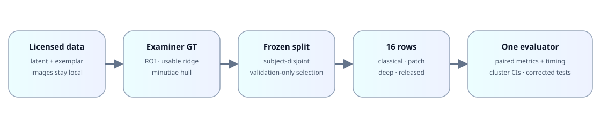

# Latent Fingerprint Segmentation Benchmark

[](LICENSE)
[](https://github.com/Udiation/latent-fingerprint-segmentation-benchmark/actions/workflows/ci.yml)
[](CHANGELOG.md)
[](#citation)

A reproducible, subject-disjoint comparison of classical, patch-based,
encoder–decoder, transformer, and released fingerprint foreground segmenters.

> **Release status — results pending.** The public repository is prepared, but
> the headline metrics remain intentionally blank until every Fig. 2 method
> has a frozen seed-zero test score or a documented N/A outcome. Partial test
> values are not published as final results.

## TL;DR

- Twelve method entries from Fig. 2 of Dhaneshwar & Wadhera (2026) are mapped
  to sixteen explicit benchmark rows plus non-ranked trivial references.
- The main endpoint uses NIST SD302 latent images and examiner ROI annotations;
  usable-ridge and exemplar-hull endpoints test the sensitivity to GT choice.
- Subjects are disjoint across train, validation, and test. Learning rates,
  stopping epochs, thresholds, and post-processing are selected on validation
  data only; the test transaction is single-use for each frozen model.
- **Headline finding:** pending the preregistered seed-zero completion gate.

## Headline results

Table A values are generated from `results/public_results.csv`; this placeholder
contains no partial result and will be replaced atomically after the gate.

<!-- BEGIN GENERATED HEADLINE RESULTS -->
| Family | Approach | Dice | Jaccard | MDR | FDR | Seeds | Params (M) | ms/img (device) |
|---|---|---:|---:|---:|---:|---:|---:|---:|
| Classical | GMFS (default) | pending | pending | pending | pending | 1 | pending | pending |
| Classical | GMFS (val-tuned) | pending | pending | pending | pending | 1 | pending | pending |
| Classical | SVM (Nyström RBF) | pending | pending | pending | pending | 3 | pending | pending |
| Classical | Random forest | pending | pending | pending | pending | 3 | pending | pending |
| Classical | Weighted ELM | pending | pending | pending | pending | 3 | pending | pending |
| Patch CNN | CNN + stacked AE | pending | pending | pending | pending | 0 | pending | pending |
| Patch CNN | AlexNet | pending | pending | pending | pending | 0 | pending | pending |
| Patch CNN | LeNet | pending | pending | pending | pending | 0 | pending | pending |
| Encoder–decoder | U-Net | pending | pending | pending | pending | 1 | pending | pending |
| Encoder–decoder | UNet++ | pending | pending | pending | pending | 0 | pending | pending |
| Encoder–decoder | DRUnet | pending | pending | pending | pending | 0 | pending | pending |
| Encoder–decoder | RUnet (no alignment) | pending | pending | pending | pending | 0 | pending | pending |
| Transformer | SegFormer-B2 (substitute†) | pending | pending | pending | pending | 0 | pending | pending |
| Pretrained | SUFS (zero-shot) | pending | pending | pending | pending | 1 | pending | pending |
| Pretrained | SUFS (fine-tuned) | pending | pending | pending | pending | 3 | pending | pending |
| Pretrained | FingerNet (pretrained) | pending | pending | pending | pending | 1 | pending | pending |
| Reference | All background | pending | pending | pending | pending | 1 | pending | pending |
| Reference | All foreground | pending | pending | pending | pending | 1 | pending | pending |
<!-- END GENERATED HEADLINE RESULTS -->

[Full result schema](results/README.md) · [Protocol](docs/PROTOCOL.md) ·
[Limitations](docs/LIMITATIONS.md)

## Overview



The same subject assignment and resolution-normalised image representation feed
every method. All final masks pass through one evaluator, followed by paired
subject-aware uncertainty and significance analyses.

## Methods mapped from the review

| Fig. 2 entry | Benchmark row(s) | Source | Implementation note |
|---|---|---|---|
| CNN & autoencoders | CNN + stacked AE | Chhabra et al. (2023) | Train-only unsupervised patch pretraining |
| GMFS & SUFS | GMFS default/tuned; SUFS zero-shot/fine-tuned | Cappelli (2023) | Released pyfing algorithms and weights |
| U-Net | U-Net | Jaafar et al. (2022); Ronneberger et al. (2015) | Four-level reimplementation |
| Adaptive Gaussian transformer | SegFormer-B2 (substitute†) | Liu et al. (2022); Xie et al. (2021) | †The reviewed OCT model is not a 2-D fingerprint model |
| DRUnet | DRUnet | Joshi et al. | Recurrent blocks with deterministic table inference |
| Recurrent adversarial network | RUnet; RA-RUnet | Joshi et al. (2021) | Alignment is used only for the declared cross-domain setting |
| Deep Nested UNets | UNet++ | Liu & Qian (2020); Zhou et al. (2018) | Nested skips and deep supervision |
| Support Vector Machine | SVM | Cortes & Vapnik (1995) | Nyström RBF approximation over shared block features |
| AlexNet & LeNet | AlexNet; LeNet | Serafim et al. (2019) | Centred patch-to-block classifiers |
| Deep CNN | FingerNet | Tang et al. (2017) | Official released segmentation head, zero-shot |
| Random decision forest | Random forest | Sankaran et al. (2017) | Shared block features and validation grid |
| Weighted extreme learning machine | Weighted ELM | Ezeobiejesi & Bhanu (2016) | W1 class weighting |

Architecture and deviation details are in [METHODS.md](docs/METHODS.md).

## Datasets

The benchmark uses NIST Special Database 302, available from the
[official NIST SD302 page](https://www.nist.gov/itl/iad/btg/nist-special-database-302).
No fingerprint image, annotation, derived mask, per-image metric, or trained
weight is distributed here.

- **SD302-Latent:** latent images plus examiner ROI and usable-ridge annotations.
- **SD302-Exemplar:** live-scan exemplars evaluated with expert-minutiae hulls,
  explicitly treated as a lower-bound region rather than full pixel GT.
- Manually annotated live-scan and palm endpoints remain conditional on human GT.

See [DATASETS.md](docs/DATASETS.md) for acquisition and reconstruction steps.

## Quick start

```bash
python -m venv .venv
source .venv/bin/activate
python -m pip install -r requirements.txt
python scripts/make_synthetic_demo.py --out examples/synthetic --subjects 6 --per-subject 2
python scripts/smoke_synthetic.py --work-dir .smoke
python site/build.py
python scripts/check_site_numbers.py
python scripts/scan_release.py
```

The smoke path is synthetic-only and is designed to finish in under five
minutes on a CPU. The same flow is available as the output-free
[`examples/synthetic/quickstart.ipynb`](examples/synthetic/quickstart.ipynb)
notebook. Its displayed metrics are pipeline checks on generated patterns, not
paper results. Once an authorised local SD302 copy is available, each paper
table has one entry point:

```bash
bash scripts/reproduce_table_A.sh --config local/benchmark.env
bash scripts/reproduce_table_A_prime.sh --config local/benchmark.env
bash scripts/reproduce_table_B1.sh --config local/benchmark.env
bash scripts/reproduce_table_D.sh --config local/benchmark.env
```

The shell entry points fail closed until the required private paths and frozen
selection receipts are supplied. They never download biometric data.

Final aggregate outputs enter the public tree through one fail-closed command.
Run its dry mode first; it validates the hash-bound aggregate-only bundle and
rebuilds the results documentation and website in isolation:

```bash
python scripts/update_from_aggregate.py \
  --bundle /path/to/public-aggregate-bundle \
  --dry-run \
  --report /path/to/dry-run-report.json
python scripts/check_release_requirements.py
```

The accepted schema and apply command are documented in
[`results/README.md`](results/README.md).

The receipt-authenticated private review interface is documented separately in
[`PRIVATE_DEMO.md`](docs/PRIVATE_DEMO.md) and
[`PRIVATE_DEMO_RUNBOOK.md`](docs/PRIVATE_DEMO_RUNBOOK.md). It is not part of
the public website and accepts only digest-pinned local artifacts.

Validation-only handoff and one-time seed delivery are described in
[`AUTONOMOUS_VALIDATION_HANDOFF.md`](docs/AUTONOMOUS_VALIDATION_HANDOFF.md) and
[`STAGE3_INCREMENTAL_RUNBOOK.md`](docs/STAGE3_INCREMENTAL_RUNBOOK.md).

## Protocol summary

- Frozen 136/24/40-subject train/validation/test assignment.
- Train-only normalisation; validation-only learning-rate, epoch, threshold,
  and post-processing selection.
- Three seeds for trainable methods; released methods retain their declared
  training regime.
- Full-image, 500-ppi pixel evaluation through one implementation.
- Subject-cluster bootstrap confidence intervals and paired Wilcoxon tests with
  Holm correction.
- Every rerun and protocol amendment is retained in an immutable audit trail.

## Project links

- [Project website](https://udiation.github.io/latent-fingerprint-segmentation-benchmark/)
- [Methodology](docs/METHODOLOGY.md)
- [Protocol](docs/PROTOCOL.md)
- [Results](docs/RESULTS.md)
- Paper: pending

## Citation

```bibtex
@software{narayan2026latentseg,
  author  = {Narayan, Udit and {TODO: co-authors}},
  title   = {Latent Fingerprint Segmentation Benchmark},
  year    = {2026},
  version = {v1.0-benchmark},
  url     = {https://github.com/Udiation/latent-fingerprint-segmentation-benchmark}
}
```

## Licence, acknowledgements, and contact

The benchmark software is MIT licensed. Dataset use remains governed by the
terms supplied with NIST SD302. We acknowledge NIST SD302, Cappelli's pyfing,
the FingerNet authors, and the Hugging Face SegFormer implementation.

Contact: open a GitHub issue for code and reproducibility questions. Requests
for weights must be reviewed separately and remain subject to dataset terms.
